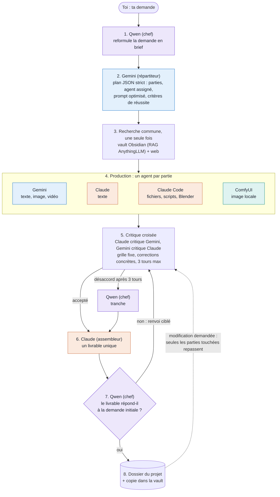
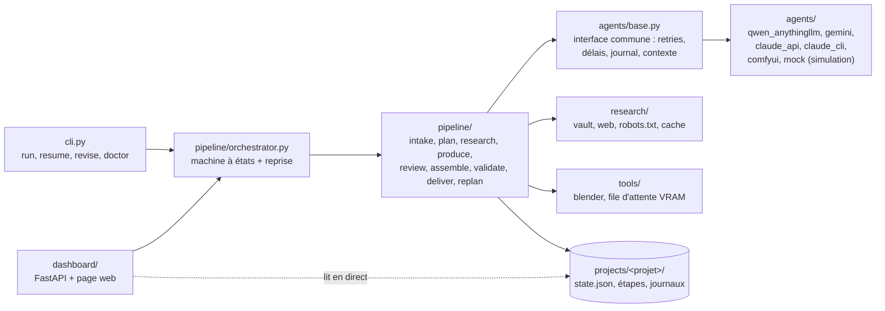
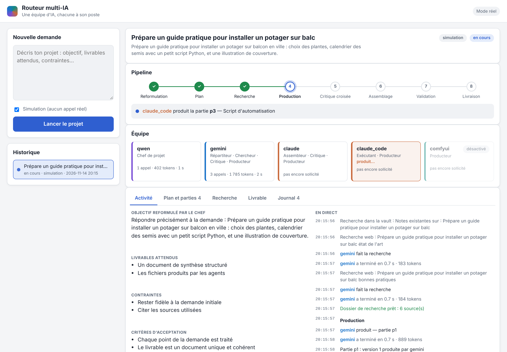
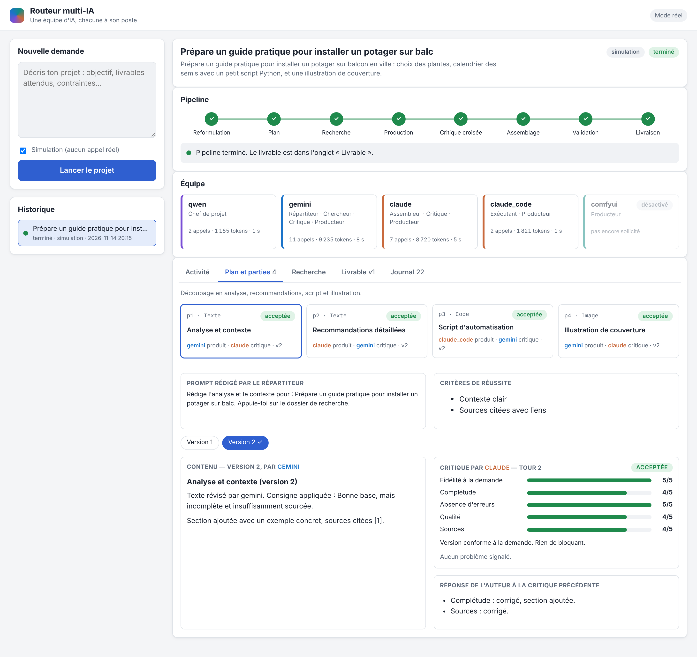

# Routeur multi-IA

Une équipe d'agents IA qui travaille comme une entreprise : un chef, un répartiteur, des producteurs, des relecteurs, un assembleur. Tu donnes une demande, l'équipe rend un livrable unique, relu et validé.

Pensé pour de gros projets occasionnels : la qualité passe avant le temps et les tokens.

- **100 % local côté orchestration**, outils gratuits et open source (Python, FastAPI, SearXNG en option). Les seules IA appelées sont celles que tu utilises déjà.
- **Tout est rejouable** : chaque étape est enregistrée dans le dossier du projet, un projet arrêté reprend là où il s'est arrêté.
- **Modifier sans tout refaire** : une demande de modification ne relance que les parties concernées.

## Sommaire

1. [Architecture](#architecture)
2. [Installation](#installation)
3. [Préparer les outils](#préparer-les-outils)
4. [Outils complémentaires (9 alternatives gratuites)](#outils-complémentaires-9-alternatives-gratuites)
5. [Configuration](#configuration)
6. [Lancement](#lancement)
7. [Exemple complet de bout en bout](#exemple-complet-de-bout-en-bout)
8. [Modifier un projet sans tout refaire](#modifier-un-projet-sans-tout-refaire)
9. [Le dossier d'un projet](#le-dossier-dun-projet)
10. [Claude : API ou Claude Code headless](#claude--api-ou-claude-code-headless)
11. [Recherche, VRAM, sécurité](#recherche-vram-sécurité)
12. [Ajouter un agent](#ajouter-un-agent)
13. [Tests](#tests)
14. [Dépannage](#dépannage)
15. [Ce qui a été vérifié, ce qui reste à vérifier chez toi](#ce-qui-a-été-vérifié-ce-qui-reste-à-vérifier-chez-toi)

## Architecture

### Le pipeline

Couleurs : violet = Qwen, bleu = Gemini, orange = Claude, vert = local.



### L'équipe

| Rôle | Agent par défaut | Ce qu'il fait |
|---|---|---|
| Chef | `qwen` (local, AnythingLLM) | Reformule la demande, arbitre les désaccords, valide le livrable final ou le renvoie en correction |
| Répartiteur | `gemini` | Découpe la demande en parties, assigne chaque partie, rédige un prompt par partie, en JSON strict |
| Producteurs | `gemini`, `claude`, `claude_code`, `comfyui` | Texte, images, vidéo (Veo), fichiers et scripts, scènes Blender |
| Relecteurs | `claude` ↔ `gemini` | Critique croisée sur une grille fixe. Personne ne juge sa propre copie |
| Assembleur | `claude` | Réunit les parties validées en un livrable unique |
| Exécutant | `claude_code` (Claude Code headless) | Écrit les fichiers ; les scripts Blender sont exécutés par le routeur |
| Chercheur | `gemini` | Recherche web et synthèse des sources avec liens |

Qui fait quoi se change dans `config.yaml`, sans toucher au code.

### Le code



## Démarrage en un clic

Dans le dossier `multi-ia-router/` :

- **Windows** : double-clique sur `demarrer.bat`.
- **Linux / macOS** : `./demarrer.sh`.

Le lanceur crée l'environnement Python, installe les dépendances, crée `.env` s'il manque, lance `python -m router doctor --write` (qui détecte ta machine et remplit `config.local.yaml`), puis ouvre le tableau de bord sur http://127.0.0.1:8765. Option `--installer-seulement` : tout préparer sans lancer le tableau de bord. Les clés restent à renseigner à la main dans `.env`.

*Le lanceur Linux est testé sur une copie propre ; la version Windows (`demarrer.bat`) n'a pas pu être exécutée sur Windows.*

## Installation

Prérequis : Python 3.12 ou plus, Git. Le reste (AnythingLLM, Claude Code, Blender, ComfyUI) est décrit plus bas.

```bash
git clone <ton dépôt>
cd ai-agents-for-beginners/multi-ia-router

python -m venv .venv
# Windows :
.venv\Scripts\activate
# Linux / macOS :
source .venv/bin/activate

pip install -r requirements.txt
```

Clés API : copie `.env.example` en `.env` et remplis-le. Le fichier `.env` n'est jamais versionné, aucune clé n'est dans le code.

```bash
# Windows : copy .env.example .env
cp .env.example .env
```

Vérifie tout de suite que l'installation fonctionne, sans aucun appel réel :

```bash
python -m router --mock run "Rédige un guide pour débuter le compost en appartement"
```

## Préparer les outils

Lance d'abord le diagnostic. Il détecte ton système, ta carte graphique et sa VRAM, Blender, Claude Code, Ollama ou LM Studio et leurs modèles Qwen, AnythingLLM et ses workspaces, ComfyUI, tes vaults Obsidian, et dit ce qui manque :

```bash
python -m router doctor            # rapport
python -m router doctor --write    # enregistre les valeurs détectées dans config.local.yaml
```

Aucune clé n'est affichée, seulement « présente » ou « absente ».

### AnythingLLM (Qwen, le chef, et la vault)

1. Dans AnythingLLM : Paramètres → Outils → API développeur → génère une clé. Mets-la dans `.env` (`ANYTHINGLLM_API_KEY`).
2. Crée un workspace **`chef`**, sans aucun document, avec ton modèle Qwen. Il sert au chef.
3. Crée un workspace **`vault`** et indexe-y ta vault Obsidian (connecteur de données ou glisser-déposer, puis « Save and Embed »). Il sert à la recherche.
4. `python -m router doctor` liste les identifiants (slugs) réels de tes workspaces. S'ils diffèrent, corrige `agents.qwen.workspace` et `research.vault.workspace`.

Règle `agents.qwen.max_context_chars` selon la fenêtre de contexte de ton Qwen (environ 4 caractères par token). Quand un document dépasse, le routeur le raccourcit en gardant tous les titres, et prévient le modèle que le contexte est coupé.

### Gemini

Clé sur <https://aistudio.google.com/apikey>, à mettre dans `.env` (`GEMINI_API_KEY`). Les noms de modèles changent souvent : `doctor` liste ceux que ta clé peut réellement utiliser et signale ceux de la config qui manquent. Ajuste `agents.gemini.model`, `image_model`, `video_model`. Pour la vidéo (Veo), ajoute `video` à `agents.gemini.capabilities` si ta clé y a accès.

### Claude Code (critique, assembleur, exécutant)

Installe Claude Code, lance `claude` une fois pour te connecter. Rien d'autre à faire : par défaut les agents `claude` et `claude_code` passent par `claude -p`. Pour passer par l'API Anthropic à la place, voir [plus bas](#claude--api-ou-claude-code-headless).

### Blender (optionnel)

`doctor --write` trouve Blender et note son chemin. Sinon, renseigne `paths.blender_bin` dans `config.local.yaml`.

### ComfyUI (optionnel, images locales)

Lance ComfyUI, puis dans `config.local.yaml` :

```yaml
agents:
  comfyui:
    enabled: true
    checkpoint: sd_xl_base_1.0.safetensors   # un modèle présent dans ComfyUI/models/checkpoints
```

Le workflow fourni convient à SDXL / Stable Diffusion. Pour Flux, exporte ton propre workflow au format API depuis ComfyUI, remplace le texte du prompt par `{{prompt}}`, et indique son chemin dans `agents.comfyui.workflow`.

## Outils complémentaires (9 alternatives gratuites)

Neuf outils open source qui remplacent des abonnements payants (présentés dans deux vidéos, sans doublon) sont rangés dans le routeur. **Rien ne s'installe ni ne démarre tout seul** : tu choisis, outil par outil.

| Outil | Remplace | Installation | Dans le routeur |
|---|---|---|---|
| [VoiceStudio](https://github.com/debpalash/VoiceStudio) | ElevenLabs | automatique (Docker) | **Branché** : agent `voix`, parties de type `audio` |
| [OpenSEO](https://github.com/every-app/open-seo) | Semrush | automatique (Docker) | Non branché (voir plus bas) |
| [Cap](https://github.com/CapSoftware/Cap) | Loom | automatique (Docker) | Outil autonome |
| [Chatwoot](https://github.com/chatwoot/chatwoot) | Intercom | automatique (Docker) | Outil autonome |
| [Cal.diy](https://github.com/calcom/cal.diy) | Calendly | manuelle | Outil autonome |
| [AppFlowy](https://github.com/AppFlowy-IO/AppFlowy) | Notion | manuelle (application de bureau) | Outil autonome |
| [Open Generative AI](https://github.com/Anil-matcha/Open-Generative-AI) (ancien nom : OpenHiggsfield) | Higgsfield | manuelle (application de bureau) | Outil autonome |
| [OpenProject](https://github.com/opf/openproject) | Asana | automatique (Docker) | Non branché |
| [OpenWhispr](https://github.com/OpenWhispr/openwhispr) | Wispr Flow | manuelle (application de bureau) | Outil autonome |

```bash
python -m router tools list                    # état de chaque outil (● en marche, ◐ installé, ○ absent, · manuel)
python -m router tools status voicestudio      # détail : dépôt, licence, prérequis, avertissements
python -m router tools install --all --dry-run # montre ce qui serait fait, sans rien exécuter
python -m router tools install voicestudio     # prépare (télécharge l'image, écrit les secrets)
python -m router tools start voicestudio       # démarre
python -m router tools stop voicestudio        # arrête (les données sont conservées)
```

Le tableau de bord affiche leur état en direct (panneau « Outils complémentaires », bouton « Ouvrir » quand un outil répond).

### Ce que fait (et ne fait pas) l'installation

- Il faut **Docker** (Docker Desktop sous Windows et macOS) et **Git**. `docker compose` doit être en version 2.24 ou plus (Chatwoot).
- Les dépôts sont clonés depuis l'adresse officielle dans `~/.multi-ia-router/tools/<outil>` (réglable : `tools.dir`).
- Les mots de passe sont **générés aléatoirement** et écrits dans des fichiers à accès réservé. Ils ne sont jamais affichés. Un `.env` existant n'est **jamais** réécrit : changer le mot de passe d'une base déjà créée la casserait.
- Les ports sont décalés pour ne pas se gêner entre eux ni avec AnythingLLM (3001) et SearXNG (8080) : VoiceStudio 3900, OpenSEO 3011, Cap 3020, Chatwoot 3030, OpenProject 8088 (réglable : `tools.ports`). Cal.diy publie le port 3000 en dur.
- Avant tout démarrage, la configuration est validée (`docker compose config`).
- `stop` arrête sans rien supprimer. Le routeur n'exécute jamais `down`, `rm`, `prune` ni `-v`.
- Aucun script distant (`curl … | sh`) n'est lancé : VoiceStudio passe par son image Docker.
- Plusieurs outils lancés ensemble consomment beaucoup de mémoire (Chatwoot, Cap, OpenSEO et OpenProject ont chacun 4 à 9 conteneurs) : démarre ceux dont tu as besoin.

### VoiceStudio : la voix dans le routeur

```bash
python -m router tools install voicestudio     # ajoute --gpu pour une carte NVIDIA
python -m router tools start voicestudio
python -m router doctor --write                # détecte le serveur et active l'agent `voix`
```

L'agent `voix` (désactivé tant que VoiceStudio n'est pas installé) lit un texte à voix haute. Dans un plan, une partie de type `audio` **dépend d'une partie `text`** qui rédige le script : c'est ce texte, nettoyé du Markdown et des renvois de sources, qui est lu. Quand le script est révisé (par la critique ou par une modification demandée), la narration est refaite automatiquement. Le relecteur, d'une autre famille que la voix, juge le texte lu : il ne peut pas écouter le fichier, et le prompt de critique le lui dit. Le lecteur audio est dans l'onglet « Plan et parties » du tableau de bord.

Pour une voix clonée : crée le profil dans l'interface de VoiceStudio (`http://127.0.0.1:3900`), puis renseigne son identifiant dans `agents.voix.voice` de `config.local.yaml`. Le clonage de voix exige l'accord de la personne concernée.

### Pourquoi les autres ne sont pas branchés

Brancher un outil sans API documentée reviendrait à inventer son contrat : il casserait en silence. Chaque point ci-dessous a été relevé dans les fichiers officiels.

- **OpenSEO** : exige une clé **DataForSEO, payante à la requête** (le logiciel, lui, est gratuit). Il expose un serveur MCP, mais la façon d'y envoyer une clé n'est pas documentée. À brancher comme source de recherche quand tu auras ton compte.
- **Cap, Chatwoot, Cal.diy, AppFlowy** : aucune API utile au pipeline. Ce sont des outils que tu ouvres toi-même.
- **OpenProject** : son API REST n'a pas pu être vérifiée (la documentation officielle est illisible depuis le conteneur de construction). Piste pour plus tard : exporter les parties d'un plan en tâches. Première connexion `admin` / `admin` : à changer aussitôt. Le dépôt d'installation est `opf/openproject-docker-compose`, branche figée sur `stable/17`.
- **OpenWhispr** : application de bureau de dictée (modèles locaux Whisper ou Parakeet, ou cloud avec ta propre clé). Son API et son serveur MCP annoncés ne sont documentés que sur un site que je n'ai pas pu lire. Usage naturel : dicter ta demande dans le champ du tableau de bord.
- **Open Generative AI** : par défaut, la génération passe par le service cloud **payant** Muapi.ai. Le local n'existe que dans l'application de bureau, sans API locale documentée. Pour des images locales pilotées par le routeur, utilise **ComfyUI** (déjà intégré). Ses installeurs sont non signés et le README demande de désactiver des protections système (SmartScreen, Gatekeeper, AppArmor) : le routeur ne le fait pas à ta place.
- **AppFlowy** : seule l'application de bureau est proposée. Son auto-hébergement n'est pas retenu : le dépôt AppFlowy-Cloud est archivé depuis septembre 2026 et son successeur est sous licence commerciale.
- **Cal.diy** : non automatisé, son README le déclare « strictement recommandé pour un usage personnel, hors production ».

## Configuration

Deux fichiers :

- `config.yaml` : les réglages par défaut, versionnés et commentés.
- `config.local.yaml` : les réglages de ton PC (chemins, modèles). Il surcharge le premier et n'est pas versionné. C'est là que tu modifies.

Exemples de changements courants, tous dans `config.local.yaml` :

```yaml
# Copier chaque livrable dans la vault
paths:
  vault_dir: "C:/Users/moi/Documents/MaVault"

# Passer Claude (critique + assembleur) sur l'API Anthropic
agents:
  claude:
    type: claude_api
    model: claude-opus-5-5

# Confier l'assemblage à Gemini et la critique de Gemini à Claude Code
roles:
  assembler: gemini

# Critique plus sévère, plus de tours
review:
  max_rounds: 4
  min_score: 5

# Recherche web via SearXNG auto-hébergé plutôt que via Gemini
research:
  web:
    provider: searxng
    searxng_url: http://localhost:8080
```

Au lancement, le routeur vérifie la cohérence : chaque rôle a un agent actif, et aucun agent ne critique un agent de la même famille (`family`). Une config incohérente est refusée avec un message clair.

Les prompts envoyés aux agents sont des fichiers texte dans `router/prompts/`. Tu peux les modifier directement, ou en faire une copie ailleurs et pointer `paths.prompts_dir` dessus.

## Lancement

### Tableau de bord web (recommandé)

```bash
python -m router dashboard
```

Ouvre <http://127.0.0.1:8765>. Tu y trouves :

- le champ pour écrire ta demande, avec une case « Simulation » pour un essai sans appel réel ;
- le pipeline en direct : étape en cours, agent qui travaille, sur quelle partie ;
- l'équipe, avec le nombre d'appels, de tokens et le temps de chacun ;
- le plan de Gemini, chaque partie avec ses versions successives, les critiques notées sur la grille, la réponse de l'auteur, l'arbitrage du chef ;
- le dossier de recherche et ses sources ;
- le livrable final, ses versions, le contrôle du chef, et le champ « Demander une modification » ;
- le journal : chaque appel, avec le prompt envoyé et la réponse reçue ;
- l'historique des projets, et le bouton « Reprendre » pour un projet arrêté.

Le tableau de bord n'écoute que sur ta machine et n'utilise aucune ressource externe.





### Ligne de commande

```bash
python -m router run "Ma demande"              # lance un projet
python -m router run -f demande.txt            # demande longue, lue depuis un fichier
python -m router list                          # historique
python -m router status <projet>               # détail d'un projet
python -m router resume <projet>               # reprend un projet arrêté
python -m router revise <projet> "Consigne"    # modifie un projet terminé
python -m router --mock run "Ma demande"       # simulation complète
python -m router tools list                    # outils complémentaires (voir plus haut)
```

`<projet>` accepte l'identifiant complet, un mot de la demande ou du titre s'il ne désigne qu'un projet (par exemple `potager`), ou `dernier` pour le plus récent. Un projet lancé en ligne de commande apparaît aussi dans le tableau de bord.

## Exemple complet de bout en bout

On part de zéro, d'abord en simulation pour voir le mécanisme, puis en réel.

**1. Simulation.** Aucun service requis.

```bash
python -m router --mock run "Prépare un guide pratique pour installer un potager sur balcon en ville : choix des plantes, calendrier des semis avec un petit script Python, et une illustration de couverture."
```

Ce que tu vois défiler (extrait) :

```
── étape : intake
appel qwen         chef.reformulation               0.0s  234→168 tokens  ok
── étape : plan
appel gemini       repartiteur.plan                 0.0s  795→623 tokens  ok
── étape : research
appel gemini       chercheur                        0.0s  132→51 tokens  ok
── étape : produce
appel gemini       producteur               p1      0.0s  851→38 tokens  ok
appel claude_code  producteur               p3      0.0s  800→17 tokens  ok
appel gemini       producteur               p4      0.0s  19→34 tokens  ok
appel claude       producteur               p2      0.0s  916→40 tokens  ok
── étape : review
appel claude       critique                 p1      0.0s  1118→162 tokens  ok
appel gemini       auteur.revision          p1      0.0s  1046→71 tokens  ok
appel claude       critique                 p1      0.0s  1200→55 tokens  ok
appel gemini       critique                 p3      0.0s  1178→162 tokens  ok
…
── étape : assemble
appel claude       assembleur                       0.0s  1236→301 tokens  ok
── étape : validate
appel qwen         chef.validation                  0.0s  759→24 tokens  ok
── étape : deliver

État    : terminé (simulation)
  partie p1     accepted   v2  par gemini
  partie p2     accepted   v2  par claude
  partie p3     accepted   v2  par claude_code
  partie p4     accepted   v2  par gemini
Livrable : …/projects/20261114-201412-prepare-un-guide-pratique-pour-installer/04_livrable/LIVRABLE.md
```

À lire ainsi : la recherche a lieu une fois, avant toute production. Pour la partie p1, Claude relit Gemini et demande des corrections, Gemini révise, Claude accepte la version 2. Pour p3, écrite par Claude Code, c'est Gemini qui relit.

**2. Regarde le résultat** dans le tableau de bord (`python -m router dashboard`) : clique sur le projet dans l'historique, puis parcours les onglets « Plan et parties », « Recherche », « Livrable », « Journal ».

**3. Demande une modification.** Seule la partie concernée repasse :

```bash
python -m router revise potager "Ajoute une section sur l'arrosage en été"
```

```
── étape : replan
appel gemini       repartiteur.modification         0.0s  656→76 tokens  ok
── étape : produce
── étape : review
appel gemini       auteur.revision          p1      0.0s  978→68 tokens  ok
appel claude       critique                 p1      0.0s  1217→162 tokens  ok
appel qwen         chef.arbitrage           p1      0.0s  539→51 tokens  ok
── étape : assemble
appel claude       assembleur                       0.0s  1637→352 tokens  ok
── étape : validate
appel qwen         chef.validation                  0.0s  830→24 tokens  ok
── étape : deliver
```

Le répartiteur a jugé que seule p1 était concernée : Gemini la révise, Claude la relit. Dans cette simulation le relecteur n'est pas satisfait au seul tour prévu après une modification (`review.rounds_after_return`), donc le chef tranche.

Les parties p2, p3, p4 et la recherche sont réutilisées telles quelles. L'ancien livrable reste disponible (`livrable_v1.md`).

**4. En réel.** Une fois `doctor` sans croix bloquante :

```bash
python -m router doctor
python -m router run "Prépare un guide pratique pour installer un potager sur balcon en ville : choix des plantes, calendrier des semis avec un petit script Python, et une illustration de couverture."
```

Mêmes étapes, avec de vrais appels. Compte de quelques minutes à plusieurs dizaines selon la taille du projet et la vitesse de ton Qwen. Si un quota est atteint en route, le projet passe « en pause » : `python -m router resume potager` plus tard, rien n'est refait.

## Modifier un projet sans tout refaire

Deux niveaux.

**Modifier un livrable.** `revise` (ou le champ « Demander une modification » du tableau de bord). Le répartiteur traduit ta consigne en plan ciblé : parties à retoucher, à ajouter, à retirer, recherche complémentaire seulement si nécessaire. Chaque partie touchée est révisée par son auteur puis relue. L'assembleur refait le livrable, le chef le valide contre ta demande initiale **et** tes modifications. Tout le reste est réutilisé. Tu peux enchaîner autant de modifications que tu veux, chaque version du livrable est conservée.

**Modifier le système lui-même.** Le code est découpé pour que chaque changement touche un seul endroit :

| Tu veux changer… | Tu modifies… |
|---|---|
| qui fait quoi, les seuils, les chemins | `config.local.yaml` |
| ce qu'on dit aux agents | `router/prompts/*.md` |
| la forme du plan, de la critique, du verdict | `router/schemas.py` |
| une étape du pipeline | `router/pipeline/<étape>.py` |
| un agent, ou en ajouter un | `router/agents/` |
| le tableau de bord | `router/dashboard/static/` |

Le fichier [`CLAUDE.md`](CLAUDE.md) décrit ces repères pour Claude Code : ouvre une session dans ce dossier, demande ta modification, et lance `python -m pytest` pour vérifier que rien n'est cassé.

## Le dossier d'un projet

```
projects/20261114-193140-prepare-un-guide-pratique-pour-installer/
├── demande.md                    ta demande, telle quelle
├── state.json                    état sauvegardé (reprise)
├── events.jsonl                  fil des événements (lu en direct par le tableau de bord)
├── 00_brief.json                 reformulation du chef
├── 01_plan.json                  plan du répartiteur
├── 02_recherche/
│   ├── recherche.md              dossier de recherche partagé, sources numérotées [S1]…
│   └── sources.json
├── 03_parties/p1/
│   ├── v1.md, v2.md …            versions successives
│   ├── v1_files/ …               fichiers de chaque version (code, images, .blend)
│   ├── critique_v1.json …        critiques (grille, problèmes, corrections)
│   ├── reponse_v2.md             réponse de l'auteur à la critique
│   └── arbitrage.json            décision du chef, s'il a dû trancher
├── 04_livrable/
│   ├── livrable_v1.md …          assemblages successifs
│   ├── assets/                   fichiers intégrés au livrable
│   └── LIVRABLE.md               le livrable final
├── 05_validation/verdict_v1.json contrôle du chef
├── modifications/modif_1.json    plans de modification
└── logs/calls.jsonl              chaque appel : agent, prompt, réponse, tokens, durée, essai, erreur
```

Un journal global est aussi écrit dans `logs/router.log`.

**Gestion des erreurs.** Chaque appel a un délai maximal et un nombre d'essais (`timeout`, `retries`, `backoff` par agent). Une erreur passagère est réessayée avec une attente croissante. Un quota ou une limite de débit persistante met le projet en pause. Une erreur définitive l'arrête proprement. Dans tous les cas l'état est sauvegardé et `resume` repart de l'appel interrompu.

**Livraison avec réserves.** Si le chef renvoie le livrable plus de `validation.max_returns` fois, ou s'il a dû trancher une critique, le livrable est remis avec une section « Réserves » qui liste noir sur blanc ce qui reste imparfait.

## Claude : API ou Claude Code headless

Les deux sont implémentés derrière la même interface. Le choix se fait par agent, avec `type`.

| | `claude_cli` : Claude Code headless (`claude -p`) | `claude_api` : API Anthropic |
|---|---|---|
| Authentification | Connexion Claude Code (abonnement) | `ANTHROPIC_API_KEY` dans `.env` |
| Coût | Inclus dans l'abonnement | Au token, facturé à part |
| JSON strict | `--json-schema` | Sortie structurée garantie par schéma |
| Tokens et durée | Fournis par Claude Code | Exacts, par appel |
| Outils fichiers | Oui : indispensable à l'exécutant | Non |
| Limites | Quota d'abonnement par fenêtre de temps : un gros projet peut être mis en pause en route. Démarrage plus lent. Moins de réglages fins | Limites de débit selon ton palier. Pas d'accès aux fichiers |

Par défaut tout passe par `claude_cli`, qui ne demande que Claude Code. L'exécutant (`claude_code`) reste toujours en `claude_cli`. Si tu as une clé API, passer l'agent `claude` en `claude_api` rend la critique et l'assemblage indépendants du quota d'abonnement.

Détails utiles :

- En `claude_cli`, le coût affiché dans le journal est celui que rapporte Claude Code (équivalent API), indicatif si tu es sous abonnement.
- En `claude_cli`, les réglages personnels de Claude Code (plugins de style, hooks) ne sont pas chargés, pour ne pas déformer les livrables. Pour les charger quand même : `setting_sources: "user,project"` sur l'agent.
- En `claude_api`, le modèle par défaut est `claude-opus-5-5`, avec repli automatique côté serveur si le modèle décline une requête (`fallbacks: false` pour le couper).

## Recherche, VRAM, sécurité

**Recherche web.** Elle est faite une seule fois par projet et partagée à toutes les parties.

- `gemini_grounding` (défaut) : Gemini interroge Google Search par la fonction officielle de son API et rend une synthèse avec ses sources. Le routeur n'aspire aucune page.
- `searxng` : métamoteur open source auto-hébergé. Le routeur lit alors les pages trouvées en respectant `robots.txt` (y compris `Crawl-delay`), avec un délai minimal entre deux requêtes vers un même site, un User-Agent explicite et un cache disque. Un site dont le `robots.txt` est illisible n'est pas lu.
- Chaque recherche est mise en cache (`cache/`, 7 jours par défaut) et limitée en débit.

**VRAM partagée.** Qwen et ComfyUI passent par une file d'attente : un seul travail sur la carte graphique à la fois. Avec `gpu.exclusive: true`, quand l'un succède à l'autre, le précédent est déchargé d'abord (Ollama, LM Studio ou commande de ton choix pour Qwen, `/free` pour ComfyUI). `doctor` propose le bon réglage selon ta VRAM.

**Sécurité.**

- Les clés restent dans `.env`. Elles ne sont ni journalisées ni affichées.
- L'exécutant n'a par défaut que des outils de fichiers, confinés au dossier de la partie. Il n'exécute aucune commande. C'est le routeur qui lance Blender. Tu peux lui donner `Bash` dans `agents.claude_code.tools`, en sachant qu'il pourra alors exécuter des commandes sur ton PC à partir de contenus venus en partie du web.
- Le tableau de bord n'écoute que sur `127.0.0.1` et refuse les requêtes venues d'un autre site.
- Le Markdown produit par les modèles est affiché avec le HTML brut neutralisé.

## Ajouter un agent

Exemple : brancher l'API OpenAI.

1. Crée `router/agents/openai.py` :

   ```python
   from .base import Agent, AgentResult, AgentTask, Usage

   class OpenAIAgent(Agent):
       type_name = "openai"
       default_capabilities = frozenset({"text"})

       def _call(self, task: AgentTask, prompt: str) -> AgentResult:
           ...  # un seul appel ; lever AgentError(retryable=…) en cas d'échec
           return AgentResult(text=texte, usage=Usage(tokens_in, tokens_out), model=modele)
   ```

2. Déclare-le dans `AGENT_TYPES` (`router/agents/__init__.py`) : `"openai": "router.agents.openai:OpenAIAgent"`.
3. Ajoute l'agent dans la config et donne-lui un rôle :

   ```yaml
   agents:
     gpt:
       type: openai
       family: openai
       model: …
   roles:
     producers: [gemini, claude, claude_code, gpt]
     critics:
       gpt: claude
   ```

Retries, délais, journalisation, réduction de contexte et correction du JSON invalide sont hérités de la classe de base.

## Tests

```bash
python -m pytest
```

La suite n'appelle aucun service réel : agents simulés, faux serveurs HTTP, faux binaires `claude` et `blender`. Elle couvre le pipeline complet, la critique croisée, l'arbitrage, les renvois, les pannes et la reprise, la modification ciblée, chaque agent, la recherche (robots.txt, débit, cache), Blender, la file VRAM, `doctor` et le tableau de bord.

## Dépannage

| Symptôme | Cause probable | Solution |
|---|---|---|
| `AnythingLLM injoignable` | AnythingLLM n'est pas lancé, ou autre port | Lance-le ; corrige `agents.qwen.base_url` |
| `AnythingLLM refuse la clé API` | Clé absente ou erronée | `ANYTHINGLLM_API_KEY` dans `.env` |
| `workspace INTROUVABLE` dans `doctor` | Le slug diffère du nom affiché | Reprends le slug listé par `doctor` |
| Qwen rend du JSON invalide en boucle | Modèle trop petit ou contexte trop court | Baisse `max_context_chars`, augmente `json_repairs`, ou prends un Qwen plus gros |
| `API Gemini HTTP 404` | Nom de modèle inexistant pour ta clé | `doctor` liste les modèles disponibles |
| Projet « en pause » | Quota ou limite de débit | Attends, puis `resume` |
| `Claude Code introuvable` | Pas installé ou pas dans le PATH | Installe-le, lance `claude` une fois |
| `Blender introuvable` | Chemin non renseigné | `doctor --write`, ou `paths.blender_bin` |
| Une partie est « tranchée par le chef » | Auteur et relecteur n'ont pas convergé | Lis l'arbitrage dans le tableau de bord ; au besoin, `revise` |

## Ce qui a été vérifié, ce qui reste à vérifier chez toi

Ce projet a été construit et testé sur une machine sans carte graphique, sans AnythingLLM, sans Blender et sans clé Gemini.

Vérifié :

- 172 tests automatiques, tous verts.
- Le pipeline complet, la reprise et la modification ciblée, en simulation, en ligne de commande et dans un vrai navigateur.
- L'agent `claude_cli` avec le vrai Claude Code : critique au format JSON, plan JSON, écriture de fichiers par l'exécutant.
- L'agent `voix` contre un **vrai serveur MCP** local (protocole réel, clé en `Bearer`, deux variantes de noms de paramètres).
- La surcharge Docker de Chatwoot, validée par le vrai `docker compose config`.

À vérifier sur ton PC, parce que cela n'a pu être testé que contre des faux serveurs :

- AnythingLLM avec ton Qwen réel : qualité du JSON, taille de contexte, noms des workspaces.
- Gemini : les noms de modèles de `config.yaml` sont à confirmer avec `doctor`, et l'accès image/vidéo dépend de ta clé.
- Blender et ComfyUI réels, et le déchargement de la VRAM selon ton moteur (Ollama ou LM Studio).
- L'export vers la vault.
- Les installations Docker des cinq outils automatisables, qui n'ont pas pu être exécutées (le conteneur de construction n'a pas de démon Docker) : la mécanique est testée avec de faux binaires et une validation de configuration réelle, pas avec les vraies images. Le contrat exact de `generate_speech` de VoiceStudio n'est pas publié sous forme de schéma : l'agent lit celui que le serveur annonce, à confirmer avec `python -m router doctor` une fois VoiceStudio démarré.
- L'étape d'initialisation de Chatwoot (`db:chatwoot_prepare`), relevée dans la documentation d'installation sans pouvoir lire le site officiel.

Commence par `python -m router doctor`, puis un petit projet réel avant un gros.
